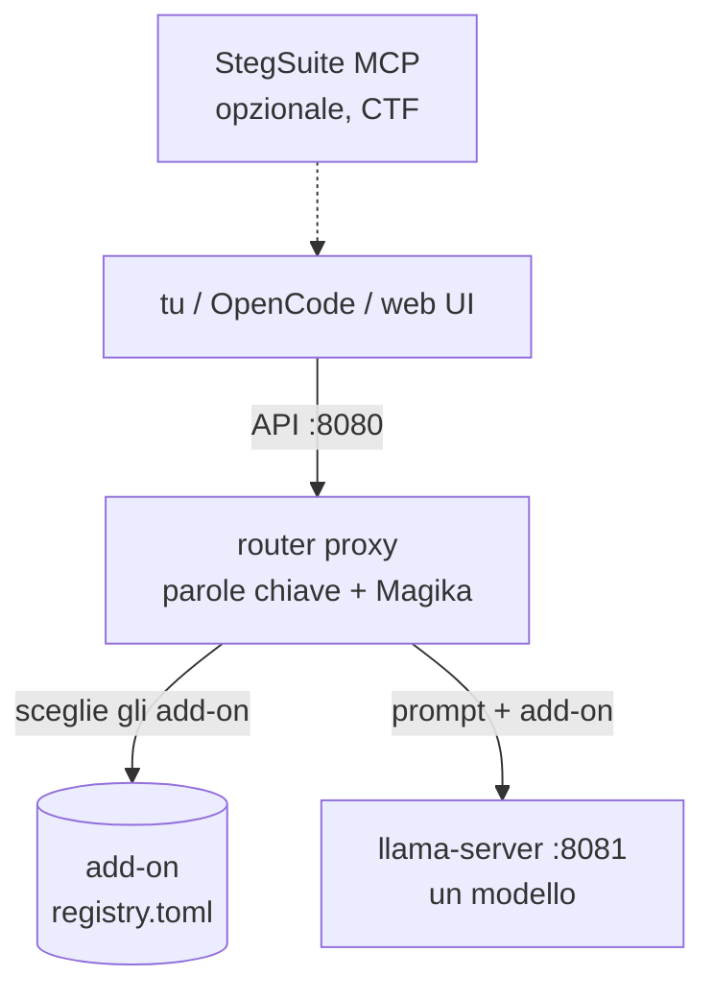

<!-- [English](README.md) | Italiano -->
# rottingAi-studio

[](LICENSE)
[](https://github.com/ggml-org/llama.cpp)
[](https://www.kernel.org/)

Uno **stack di AI locale** minimale e riproducibile per macchine CPU-only
(16 GB di RAM, AVX2), costruito su **llama.cpp** e **OpenCode**: **un solo modello
base sempre caricato**, più **add-on** scelti per ogni richiesta da un **router**
piccolo e veloce — nessun cambio di modello.

> **In breve** — `./ai start` carica un GGUF (Qwen3.5-9B) in un `llama-server`
> nativo e ci mette davanti un router. Per ogni richiesta il router (regole a
> parole chiave + Magika, non un LLM) sceglie una categoria e gli add-on che
> servono al modello — es. una guida da Python senior o una guida ai comandi
> Linux — e li aggiunge in fondo al contesto. Usabile da OpenCode e da qualunque
> client OpenAI-compatibile.

---

## Perché esiste

Su una macchina solo CPU la parte costosa è cambiare modello: richiede tempo e,
soprattutto, butta via il contesto (cache KV), quindi tutta la conversazione va
rielaborata su CPU. Questa repo tiene **un solo modello caricato** e lo rende
specialista su richiesta aggiungendo add-on testuali.

- **Un modello, sempre acceso**: niente ricaricamenti, la cache KV vale per tutta la conversazione.
- **Add-on solo in fondo al contesto**: il prefisso già elaborato non cambia mai,
  quindi non viene mai rielaborato.
- **Il router non è un LLM**: classificatori che rispondono sì/no in millisecondi.
- Nativo, nessun daemon oltre allo stack stesso, offline dopo il primo download.

## Architettura



1. Il prompt dell'utente resta **intatto**.
2. Il router legge gli **ultimi messaggi dell'utente** (non solo l'ultimo) e
   produce flag sì/no: una **categoria** (`coding`, `sysadmin`) e gli **add-on**.
   Il linguaggio di file e codice lo dà **Magika** (~5 ms su CPU).
3. Sotto la soglia di confidenza **non tira a indovinare**: nessun add-on, il
   modello base risponde normalmente.
4. Gli add-on scelti vanno **nel turno utente corrente, prima del prompt**. Una
   volta aggiunti restano nella stessa posizione fino a fine conversazione: mai
   scaricati o spostati, così la cache KV resta valida.

Il ragionamento completo è in [`docs/architecture.md`](docs/architecture.md); il
brief del progetto è [`CLAUDE.md`](CLAUDE.md).

## Add-on

| Add-on | Categoria | Tipo | ~Token | Attivato da |
|---|---|---|---|---|
| `python` | coding | istruzioni | 1500 | Magika `python`, parole chiave (pip, pytest, venv…) |
| `linux-commands` | sysadmin | istruzioni | 1650 | default di `sysadmin`, Magika `shell` |
| `arch-sysadmin` | sysadmin | skill | 580 | pacman, AUR, btrfs, CachyOS… |
| `proxmox` | sysadmin | skill | 360 | proxmox, qm, pct, lxc… |
| `ctf-triage` | ctf | istruzioni | 590 | qualsiasi richiesta CTF (default) |
| `docker` | condiviso | skill | 350 | docker, compose, container… (qualsiasi categoria) |
| `regex` | condiviso | istruzioni | 290 | regex, lookahead, lookbehind, gruppo di cattura… (qualsiasi categoria) |
| `git` | condiviso | istruzioni | 380 | rebase, branch, commit, stash, pull request… (qualsiasi categoria) |
| `sql` | condiviso | istruzioni | 370 | query, JOIN, GROUP BY, postgres, sqlite… (qualsiasi categoria) |

Tipi, dal più economico: istruzioni → skill → tool → LoRA (solo se misurato
necessario). Budget: `max_addon_tokens` (4000) per conversazione. Per aggiungerne
uno: un file Markdown + una voce in `addons/registry.toml`, poi `./ai router-check`.

## Requisiti

- Linux x86_64 con **AVX2** (qualunque CPU Intel/AMD moderna)
- **16 GB di RAM** (budget ~8–10 GB per il modello; zram consigliato)
- `git`, `cmake`, `make`, un compilatore C++ (`gcc`/`clang`) per llama.cpp
- Python 3.11+ (router: solo libreria standard; Magika opzionale)

## Avvio rapido

Solo la prima volta: compila llama.cpp, poi `setup` scarica tutto il resto.

```bash
git clone https://github.com/dexRand/rottingAi-studio.git
cd rottingAi-studio

cp .env.example .env                # porte / API key se serve
./scripts/install.sh native         # compila llama.cpp con -march=native
./ai setup                          # modello di default (Qwen3.5-9B) + dipendenze router (Magika)
./ai setup --all                    # anche i modelli lite e ctf (~13 GB totali)

./ai chat                           # avvia modello + router, apre la web UI
./ai route "come vedo chi usa la porta 8080?" --show   # cosa aggiungerebbe il router?
./ai stop                           # ferma e libera la RAM
```

- `./ai setup` è il comando unico per il primo avvio: controlla il binario
  `llama-server`, scarica il modello di default e installa il venv del router
  (Magika → riconoscimento file/codice). Su una macchina da 16 GB che serve solo
  `lite`, usa `./ai download lite`.
- `./ai` da solo apre l'agente da terminale; `./ai "prompt"` lo avvia con un prompt.

## Uso

```text
./ai                       chat con l'AGENTE locale nella cartella corrente: esegue
                         comandi e legge/modifica file (chiede approvazione),
                         mostra il ragionamento, gli strumenti e le statistiche della cache
./ai "prompt"              uguale, partendo da questo prompt; si apre in una NUOVA finestra
                         (--here = questo terminale, -p = una sola risposta, -a = auto mode: niente conferme)
./ai chat                avvia modello + router (se serve) + apre la web UI
./ai start [ruolo]       avvia solo modello + router (ruolo: base | lite | ctf)
./ai stop                ferma tutto e libera la RAM
./ai status              stato modello + router + RAM
./ai logs [router]       segue il log di llama-server (o del router)
./ai cli [ruolo]         chat da terminale via llama-cli (senza server né router)
./ai route "testo" [--file F] [--history "msg"] [--show]
./ai route-eval [file.jsonl] [--backend B] [-v]
./ai router-check        valida il registro e le dimensioni degli add-on
./ai router-install      .venv con Magika (+ GLiClass sperimentale)
./ai download [--all|<ruolo>]
./ai setup [--all] [--no-router]
./ai benchmark [ruolo] [thread]
./ai upgrade [all|runtime|skills|check]
./ai healthcheck         integrità + salute
./ai test [--skills-only] [--models RUOLI...]
```

## Modelli

| Ruolo | Modello | Quant | Dimensione | Uso |
|---|---|---|---|---|
| `base` | Qwen3.5-9B | Q4_K_M | 5,68 GB | **il** modello: sempre acceso, thinking spento di default |
| `lite` | Qwen3.5-4B | Q4_K_M | 2,74 GB | alternativa più veloce per macchine deboli (al posto di `base`) |
| `ctf` | WhiteRabbitNeo-2.5 (Qwen2.5-Coder-7B) | Q4_K_M | 4,68 GB | eccezione rara: sicurezza / CTF, avviato esplicitamente |

Ne gira uno alla volta. `base` è il candidato principale e va ancora
confermato con `./ai benchmark` sulla CPU di destinazione. I modelli stanno
**fuori dalla repo** (`MODELS_DIR`, default `~/local-ai/models`); vedi `docs/models.md`.

## Backend del router

| Backend | Stato | Note |
|---|---|---|
| `keywords` | **default** | regole da `addons/registry.toml`, nessuna dipendenza, prevedibile |
| `gliclass` | sperimentale | zero-shot; misurato **1/8 – 5/8** su prompt italiani, non riconosce mai "altro argomento" |
| mmBERT-small / SetFit | previsto | addestrato su esempi italiani reali, misurato con `./ai route-eval` |

## Integrazione OpenCode

Copia `config/opencode/opencode.jsonc` nella root del progetto (o in
`~/.config/opencode/`) e lancia `./ai start`. OpenCode parla col router su
`:8080`; il modello compare come `local/base` con tool calling attivo. Le skill
grandi restano in `.opencode/skills/` e le carica OpenCode stesso; quelle
piccole sono anche add-on del router.

## Accesso API

Il router espone l'API OpenAI-compatibile su `/v1` a `127.0.0.1:8080` e inoltra
a `llama-server`, sempre legato a `127.0.0.1:8081`. Imposta `ROUTER_HOST=0.0.0.0`
in `.env` per renderlo raggiungibile dalla LAN e `LLAMA_API_KEY` per richiedere
`Authorization: Bearer`. Ogni risposta ha gli header `X-Router-Category` /
`X-Router-Addons`; `GET /router/status` (solo locale) mostra gli add-on per conversazione.

```bash
curl http://127.0.0.1:8080/v1/chat/completions \
  -H 'Content-Type: application/json' \
  -d '{"messages":[{"role":"user","content":"Come riavvio nginx con systemctl?"}]}'
```

## Skill

42 skill sono vendored offline in `.opencode/skills/` e raggruppate per
categoria nel `[catalog]` di `addons/registry.toml` (coding, sysadmin, ctf,
meta). Origini e licenze in `.opencode/skills/README.md`.

## Aggiornamento e manutenzione

```bash
./ai upgrade          # repo + llama.cpp + skill vendored
./ai upgrade check    # versioni / stato (nessuna modifica)
./ai healthcheck      # integrità modelli + router + endpoint + RAM
```

Vedi `docs/upgrading.md` per il quadro completo.

## Struttura

```
rottingAi-studio/
├── ai -> scripts/ai     # entry point principale
├── router/              # router: registro, Magika, intento, composer, proxy (stdlib)
│   └── examples/        # prompt etichettati per ./ai route-eval
├── addons/
│   ├── registry.toml    # categorie, add-on, catalogo skill
│   ├── coding/          # python.md
│   └── sysadmin/        # linux-commands.md
├── scripts/             # lib.sh, start/stop/status, install, download, benchmark, upgrade
├── config/
│   ├── llama.cpp/roles.conf     # modello base (+ alternative lite / ctf)
│   ├── router.toml              # backend, soglia, storico, budget token
│   └── opencode/opencode.jsonc  # provider OpenCode -> router
├── .opencode/skills/    # 42 skill vendored
├── models/              # istruzioni download + checksum (GGUF non versionati)
├── docs/                # architecture, models, upgrading, troubleshooting
├── tests/               # unit test (python3 -m unittest discover -s tests)
└── docker-compose.yml   # servizi opzionali (GUI) — spenti di default
```

## Sicurezza

- In ascolto su `127.0.0.1` di default; l'esposizione in LAN è opt-in via
  `ROUTER_HOST`. `llama-server` non è mai esposto direttamente.
- Gli add-on sono file locali di questa repo: il router non scarica nulla.
- Nessun socket Docker montato nei container AI, nessun mount della root host,
  nessun `sudo` automatico, nessun invio dati fuori dalla macchina, approvazione
  esplicita dei comandi agentici.

## Contribuire

Si lavora sempre tramite issue: aprine una prima, poi un branch
`<type>/<n>-<slug>`, poi una PR con `Closes #<n>`. Vedi
[CONTRIBUTING.md](CONTRIBUTING.md) per il flusso completo.

## Licenza

[MIT](LICENSE) © 2026 dexRand. Le skill vendored mantengono le proprie licenze MIT
