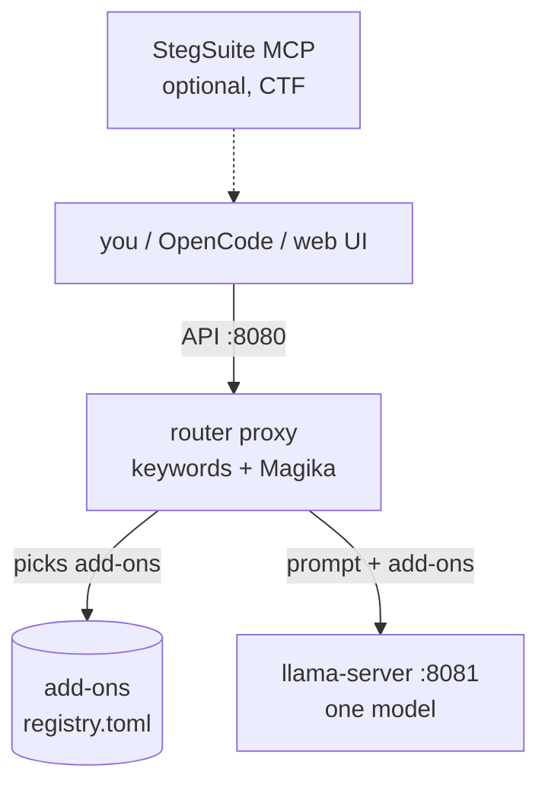

<!-- English | [Italiano](README.it.md) -->
# rottingAi-studio

[](LICENSE)
[](https://github.com/ggml-org/llama.cpp)
[](https://www.kernel.org/)

A minimal, reproducible **local AI stack** for CPU-only machines (16 GB RAM, AVX2),
built on **llama.cpp** and **OpenCode**: **one base model always loaded**, plus
**add-ons** chosen per request by a small, fast **router** — no model switching.

> **TL;DR** — `./ai start` loads one GGUF (Qwen3.5-9B) in a native `llama-server`
> and puts a router in front of it. For every request the router (keyword rules +
> Magika, not an LLM) picks a category and the add-ons the model needs — e.g. a
> senior-Python guide or a Linux-commands guide — and appends them at the end of
> the context. Usable from OpenCode and any OpenAI-compatible client.

---

## Why this exists

On a CPU-only machine, switching models is the expensive part: it takes time
and, worse, it throws away the context (KV cache), so the whole conversation is
re-processed on CPU. This repo keeps **one model loaded** and makes it a
specialist on demand by adding text add-ons instead.

- **One model, always on**: no reloads, the KV cache survives the whole conversation.
- **Add-ons at the end of the context only**: the prefix the model already
  processed never changes, so it is never re-processed.
- **The router is not an LLM**: classifiers that answer yes/no in milliseconds.
- Native, no daemons beyond the stack itself, fully offline after the first download.

## Architecture



1. The user's prompt stays **intact**.
2. The router reads the **last few user messages** (not only the last one) and
   produces yes/no flags: a **category** (`coding`, `sysadmin`) and **add-ons**.
   File/code language comes from **Magika** (~5 ms on CPU).
3. Below the confidence threshold it makes **no guess**: no add-ons, the base
   model answers as usual.
4. The chosen add-ons are put **in the current user turn, before the prompt**.
   Once added they stay at the same position until the conversation ends: never
   unloaded or moved, so the KV cache stays valid.

Full reasoning in [`docs/architecture.md`](docs/architecture.md); the project
brief is [`CLAUDE.md`](CLAUDE.md).

## Add-ons

| Add-on | Category | Type | ~Tokens | Triggered by |
|---|---|---|---|---|
| `python` | coding | instructions | 1500 | Magika `python`, keywords (pip, pytest, venv…) |
| `javascript` | coding | instructions | 623 | keywords (js, ts, typescript, npm, .js, .ts, .tsx…), Magika javascript/typescript |
| `laravel` | coding | instructions | 570 | keywords (laravel, php, eloquent, blade, artisan…), Magika php |
| `vue` | coding | instructions | 582 | keywords (vue, vuejs, pinia, vite.config, .vue…) |
| `linux-commands` | sysadmin | instructions | 1650 | default of `sysadmin`, Magika `shell` |
| `arch-sysadmin` | sysadmin | skill | 580 | pacman, AUR, btrfs, CachyOS… |
| `proxmox` | sysadmin | skill | 360 | proxmox, qm, pct, lxc… |
| `ctf-triage` | ctf | instructions | 590 | any CTF request (default), Magika elf/pebin/wasm |
| `docker` | shared | skill | 350 | docker, compose, container… (any category) |
| `regex` | shared | instructions | 290 | regex, lookahead, lookbehind, capture group… (any category) |
| `git` | shared | instructions | 380 | rebase, branch, commit, stash, pull request… (any category) |
| `sql` | shared | instructions | 370 | query, JOIN, GROUP BY, postgres, sqlite… (any category) |
| `http` | shared | instructions | 352 | http, api, endpoint, curl, fetch, request, bearer, webhook… (any category) |
| `summarize` | shared | instructions | 310 | riassumi, summar, sintesi, tldr, bullet, punti chiave… (any category) |
| `translate` | shared | instructions | 309 | traduci, translate, in inglese, in italiano, into english… (any category) |
| `humanize` | shared | instructions | 331 | humanize, umanizza, più umano, più naturale, meno robotico… (any category) |
| `bash-scripting` | shared | instructions | 308 | bash script, shell script, scrivi uno script, shebang, shellcheck, set -euo pipefail… (any category) |

Types, cheapest first: instructions → skill → tool → LoRA (only if measured
necessary). Budget: `max_addon_tokens` (4000) per conversation. Add one by
writing a Markdown file and an entry in `addons/registry.toml`, then
`./ai router-check`.

## Requirements

- Linux x86_64 with **AVX2** (any modern Intel/AMD CPU)
- **16 GB RAM** (budget ~8–10 GB for the model; zram swap recommended)
- `git`, `cmake`, `make`, a C++ compiler (`gcc`/`clang`) to build llama.cpp
- Python 3.11+ (router: stdlib only; Magika optional)

## Quick start

First run only: build llama.cpp, then let `setup` fetch everything else.

```bash
git clone https://github.com/dexRand/rottingAi-studio.git
cd rottingAi-studio

cp .env.example .env                # adjust ports / API key if needed
./scripts/install.sh native         # build llama.cpp with -march=native
./ai setup                          # default model (Qwen3.5-9B) + router deps (Magika)
./ai setup --all                    # also lite + ctf models (~13 GB total)

./ai chat                           # start model + router, open the web UI
./ai route "come vedo chi usa la porta 8080?" --show   # what would the router add?
./ai stop                           # stop and free the RAM
```

- `./ai setup` is the one-shot for first run: it checks the llama-server binary,
  downloads the default model, and installs the router venv (Magika → file/code
  detection). On a 16 GB machine that only needs `lite`, use `./ai download lite`.
- `./ai` alone opens the terminal agent; `./ai "prompt"` starts it with a prompt.

## Usage

```text
./ai                       chat with the local AGENT in the current directory:
                         it runs commands and reads/edits files (asks approval),
                         shows its thinking, tool calls and KV-cache stats
./ai "prompt"              same, starting with this prompt; opens in a NEW terminal window
                         (--here = this terminal, -p = one shot, -a = auto mode: no approvals)
./ai chat                start model + router (if needed) + open the web UI
./ai start [role]        start model + router only (role: base | lite | ctf)
./ai stop                stop everything and free RAM
./ai swap [role]         stop current model + start another (base | lite | ctf)
./ai status              model + router + RAM status
./ai logs [router]       follow the llama-server (or router) log
./ai cli [role]          terminal chat via llama-cli (no server, no router)
./ai route "text" [--file F] [--history "msg"] [--show]
./ai route-eval [file.jsonl] [--backend B] [-v]
./ai route-train <dataset.jsonl...>   fit + save the tf-idf classifier (needs sklearn)
./ai router-check        validate the registry and add-on sizes
./ai router-install [--gliclass] [--tfidf]
                         .venv with Magika (+ experimental GLiClass / tf-idf)
./ai download [--all|<role>]
./ai setup [--all] [--no-router]
./ai benchmark [role] [threads]
./ai upgrade [all|runtime|skills|check]
./ai healthcheck         integrity + health
./ai test [--skills-only] [--models ROLES...]
```

## Models

| Role | Model | Quant | Size | Use |
|---|---|---|---|---|
| `base` | Qwen3.5-9B | Q4_K_M | 5.68 GB | **the** model: always on, thinking off by default |
| `lite` | Qwen3.5-4B | Q4_K_M | 2.74 GB | faster alternative for weaker machines (instead of `base`) |
| `ctf` | WhiteRabbitNeo-2.5 (Qwen2.5-Coder-7B) | Q4_K_M | 4.68 GB | rare exception: security / CTF, started explicitly |

Only one runs at a time. `base` is the main candidate and still has to be
confirmed with `./ai benchmark` on the target CPU. Models live **outside the
repo** (`MODELS_DIR`, default `~/local-ai/models`); see `docs/models.md`.

## Router backends

| Backend | Status | Notes |
|---|---|---|
| `keywords` | **default** | rules from `addons/registry.toml`, no dependencies, predictable |
| `gliclass` | experimental | zero-shot; measured **1/8 – 5/8** on Italian prompts, never recognised "other topic" |
| `tfidf` | baseline/experimental | sklearn tf-idf + LinearSVC, predicts category only, **NOT** default, needs `./ai router-install --tfidf` + `./ai route-train` |
| mmBERT-small / SetFit | planned | trained on real Italian examples, measured with `./ai route-eval` |

## OpenCode integration

Copy `config/opencode/opencode.jsonc` to your project root (or
`~/.config/opencode/`) and run `./ai start`. OpenCode talks to the router on
`:8080`; the model appears as `local/base` with tool calling enabled. Large
skills stay in `.opencode/skills/` and are loaded by OpenCode itself; small ones
are also router add-ons.

## API access

The router exposes the OpenAI-compatible API at `/v1` on `127.0.0.1:8080` and
forwards to `llama-server`, which is always bound to `127.0.0.1:8081`. Set
`ROUTER_HOST=0.0.0.0` in `.env` to make it reachable from the LAN and
`LLAMA_API_KEY` to require `Authorization: Bearer`. Every response carries
`X-Router-Category` / `X-Router-Addons` headers; `GET /router/status` (local
only) shows the add-ons per conversation.

```bash
curl http://127.0.0.1:8080/v1/chat/completions \
  -H 'Content-Type: application/json' \
  -d '{"messages":[{"role":"user","content":"Come riavvio nginx con systemctl?"}]}'
```

## Skills

42 skills are vendored offline in `.opencode/skills/` and grouped by category in
the `[catalog]` of `addons/registry.toml` (coding, sysadmin, ctf, meta). See
`.opencode/skills/README.md` for origins and licenses.

## Upgrading & maintenance

```bash
./ai upgrade          # repo + llama.cpp + vendored skills
./ai upgrade check    # versions / status (no changes)
./ai healthcheck      # model integrity + router + endpoints + RAM
```

See `docs/upgrading.md` for the full picture.

## Project structure

```
rottingAi-studio/
├── ai -> scripts/ai     # main entry point
├── router/              # router: registry, Magika, intent, composer, proxy (stdlib)
│   └── examples/        # labelled prompts for ./ai route-eval
├── addons/
│   ├── registry.toml    # categories, add-ons, skill catalog
│   ├── coding/          # python.md
│   └── sysadmin/        # linux-commands.md
├── scripts/             # lib.sh, start/stop/status, install, download, benchmark, upgrade
├── config/
│   ├── llama.cpp/roles.conf     # base model (+ lite / ctf alternatives)
│   ├── router.toml              # backend, threshold, history, token budget
│   └── opencode/opencode.jsonc  # OpenCode provider -> router
├── .opencode/skills/    # 42 vendored skills
├── models/              # download instructions + checksums (GGUF not versioned)
├── docs/                # architecture, models, upgrading, troubleshooting
├── tests/               # unit tests (python3 -m unittest discover -s tests)
└── docker-compose.yml   # optional services (GUI) — off by default
```

## Security

- Binds to `127.0.0.1` by default; LAN exposure is opt-in via `ROUTER_HOST`.
  `llama-server` itself is never exposed.
- Add-ons are local files from this repo: the router never fetches anything.
- No Docker socket mounted into AI containers, no root host mounts, no automatic
  `sudo`, no data sent off-machine, explicit approval for agent commands.

## Contributing

Work always goes through issues: open one first, then a branch
`<type>/<n>-<slug>`, then a PR with `Closes #<n>`. See
[CONTRIBUTING.md](CONTRIBUTING.md) for the full workflow.

## License

[MIT](LICENSE) © 2026 dexRand. Vendored skills retain their own MIT licenses
