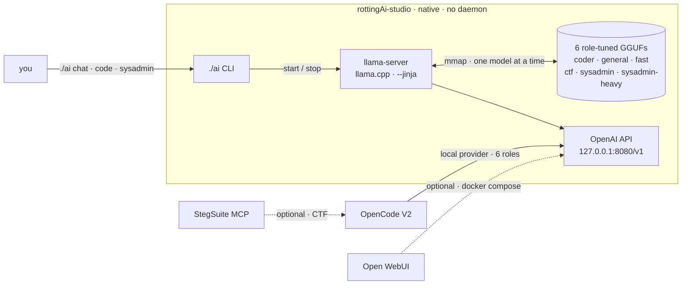

<!-- English | [Italiano](README.it.md) -->
# rottingAi-studio

[](LICENSE)
[](https://github.com/ggml-org/llama.cpp)
[](https://cachyos.org/)

A minimal, reproducible **local AI stack** for CPU-only machines (16 GB RAM, AVX2),
built on **llama.cpp** and **OpenCode**. No daemons, no idle services, one model at
a time — the machine stays responsive while you work.

> **TL;DR** — six role-tuned GGUF models served on demand by a native
> `llama-server`, driven by a small `./ai` CLI, and usable from OpenCode and any
> OpenAI-compatible client.

---

## Why this exists

Local LLM inference is usually either heavy (Ollama daemon, Docker, GPU runtimes)
or generic advice that doesn't fit a specific machine. This repo is the opposite:
a **native, on-demand** setup tuned for a real constraint — a 4-core/8-thread CPU
with AVX2 and 16 GB of RAM — where **desktop responsiveness is the top priority**.

- Load a model only when you need it, unload it instantly (mmap release).
- One model at a time, bounded threads, moderate context.
- No always-on services, no container overhead for inference.
- Fully offline after the first download.

## Architecture



One `./ai` command starts a single on-demand `llama-server`, which mmaps one
role-tuned GGUF at a time and serves an OpenAI-compatible API on `:8080`.
OpenCode (and optionally Open WebUI) consume that same endpoint — the full
reasoning is in `docs/architecture.md`.

The `StegSuite MCP` node is the one cross-repo link: it is **not** part of this
repo. It is served by the separate [CTF Toolbox](https://github.com/dexRand/ctf-docker)
repository — a Docker Compose workbench for CTFs, built around StegSuite — and
wired in here through `config/opencode/opencode.jsonc`. Start it over there with
`./ctf up`; when it is not running, OpenCode starts normally, just without the
CTF tools.

## Features

- **Native llama.cpp** (`llama-server` + `llama-cli`), AVX2/FMA/F16C build.
- **Six role-tuned models** (coding / general / fast / ctf / sysadmin + optional heavy).
- **`./ai` CLI** — start/stop/status/chat/benchmark/upgrade in one command.
- **OpenAI-compatible API** on `/v1` (LAN-reachable, optional Bearer auth).
- **42 skills** vendored offline (find-skills + addyosmani dev skills + ljagiello CTF skills + custom).
- **OpenCode V2** integration with tool calling (`--jinja`).
- Optional Docker Compose for GUI/RAG — all off by default.
- Checksum-verified model downloads, reproducible benchmarks.

## Requirements

- Linux x86_64 with **AVX2** (any modern Intel/AMD CPU)
- **16 GB RAM** (zram swap recommended)
- `git`, `cmake`, `make`, a C++ compiler (`gcc`/`clang`) to build llama.cpp
- Arch / CachyOS (tested); any Linux with the above works too

## Quick start

```bash
git clone https://github.com/dexRand/rottingAi-studio.git
cd rottingAi-studio

cp .env.example .env                # adjust host / port / API key if needed
./scripts/install.sh native         # build llama.cpp with -march=native
./scripts/download-models.sh --all  # download the 6 GGUFs (with checksums)

./ai chat                   # start + open the built-in web UI (general)
./ai code                   # coding model (Qwen2.5-Coder-7B)
./ai sysadmin               # sysadmin model (Qwen2.5-7B)
./ai stop                   # stop and free the RAM
```

## Usage

```text
./ai chat [role]        start server (if needed) + open the built-in web UI
./ai code               coding model (Qwen2.5-Coder-7B)
./ai fast               superfast 4B model (Qwen3.5-4B)
./ai ctf                security helper (WhiteRabbitNeo-2.5)
./ai sysadmin           sysadmin model (Qwen2.5-7B Q5)
./ai sysadmin-heavy     optional heavy sysadmin (Gemma 3 12B)
./ai cli [role]         terminal chat via llama-cli (no server)
./ai start <role>       start llama-server only
./ai stop               stop and free RAM
./ai status             runtime + model + RAM status
./ai logs               follow the server log
./ai download [--all|<role>]
./ai benchmark <role> [threads]
./ai upgrade [all|runtime|skills|check]
./ai healthcheck        integrity + health
```

## Models

| Role | Model | Quant | Size | RAM | Use |
|---|---|---|---|---|---|
| `coder` | Qwen2.5-Coder-7B-Instruct | Q4_K_M | 4.68 GB | ~5.5 GB | coding, OpenCode backend |
| `general` | Qwen3-8B | Q4_K_M | 5.03 GB | ~6 GB | multilingual, reasoning, chat |
| `fast` | Qwen3.5-4B | Q4_K_M | 2.74 GB | ~3.5 GB | superfast, quick tasks |
| `ctf` | WhiteRabbitNeo-2.5 (Qwen2.5-Coder-7B) | Q4_K_M | 4.68 GB | ~5.5 GB | security / CTF / pentesting |
| `sysadmin` | Qwen2.5-7B-Instruct | Q5_K_M | 5.44 GB | ~6 GB | technical, fast |
| `sysadmin-heavy` | Gemma 3 12B | Q4_K_M | 7.30 GB | ~9 GB | optional: depth, 128K context |

Models live **outside the repo** (`MODELS_DIR`, default `~/local-ai/models`) and are
never versioned. Quant types and sources are documented in `models/README.md`.

## OpenCode integration

Copy `config/opencode/opencode.jsonc` to your project root (or
`~/.config/opencode/`) and start `./ai start <role>`. The llama.cpp roles appear
as `local/coder`, `local/general`, `local/fast`, `local/ctf`, `local/sysadmin`
and `local/sysadmin-heavy`, all with tool calling enabled.

## API access

`llama-server` exposes an OpenAI-compatible API at `/v1`. By default it binds to
`127.0.0.1`; set `LLAMA_HOST=0.0.0.0` in `.env` to make it reachable from the LAN,
and `LLAMA_API_KEY` to protect it with `Authorization: Bearer`.

```bash
curl http://127.0.0.1:8080/v1/chat/completions \
  -H 'Content-Type: application/json' \
  -d '{"model":"qwen3-8b","messages":[{"role":"user","content":"Hello!"}]}'
```

## Skills

42 skills are vendored offline in `.opencode/skills/`: `find-skills`
(discover/install skills from `skills.sh`), 25 development skills from
`addyosmani/agent-skills`, 11 CTF skills from `ljagiello/ctf-skills`, and 5 custom
ones (`local-ai`, `arch-sysadmin`, `ctf-toolbox`, `docker`, `proxmox`).

## Upgrading & maintenance

```bash
./ai upgrade          # repo + llama.cpp + vendored skills
./ai upgrade check    # versions / status (no changes)
./ai healthcheck      # model integrity + endpoint + RAM
```

See `docs/upgrading.md` for the full picture (including pinning llama.cpp/models).

## Project structure

```
rottingAi-studio/
├── ai -> scripts/ai  # main entry point
├── scripts/          # install, download, start/stop/status, benchmark, upgrade, ai
├── config/
│   ├── llama.cpp/roles.conf     # role → model/alias/context presets
│   └── opencode/opencode.jsonc  # OpenCode local provider
├── .opencode/
│   ├── skills/       # 42 vendored skills
│   └── references/   # shared checklists for the skills
├── models/           # download instructions + checksums (GGUFs not versioned)
├── docs/             # architecture, models, upgrading, troubleshooting
├── tests/            # test scripts
├── docker-compose.yml# optional services (GUI/RAG) — off by default
└── benchmarks/results/  # measured benchmark output
```

## Security

- Binds to `127.0.0.1` by default; LAN exposure is opt-in via `LLAMA_HOST`.
- No Docker socket mounted into AI containers, no root host mounts, no automatic
  `sudo`, no data sent off-machine, explicit approval for agent commands.

## License

[MIT](LICENSE) © 2026 dexRand. Vendored skills retain their own MIT licenses
(see `.opencode/skills/README.md`).
